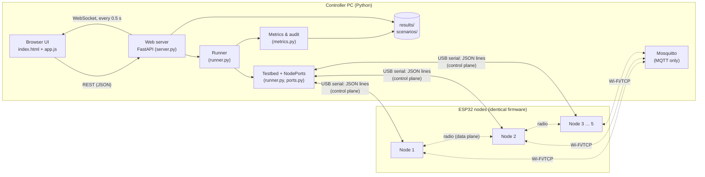
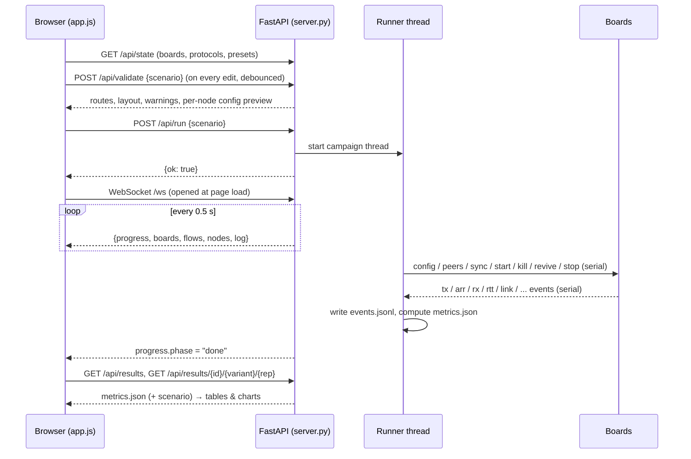
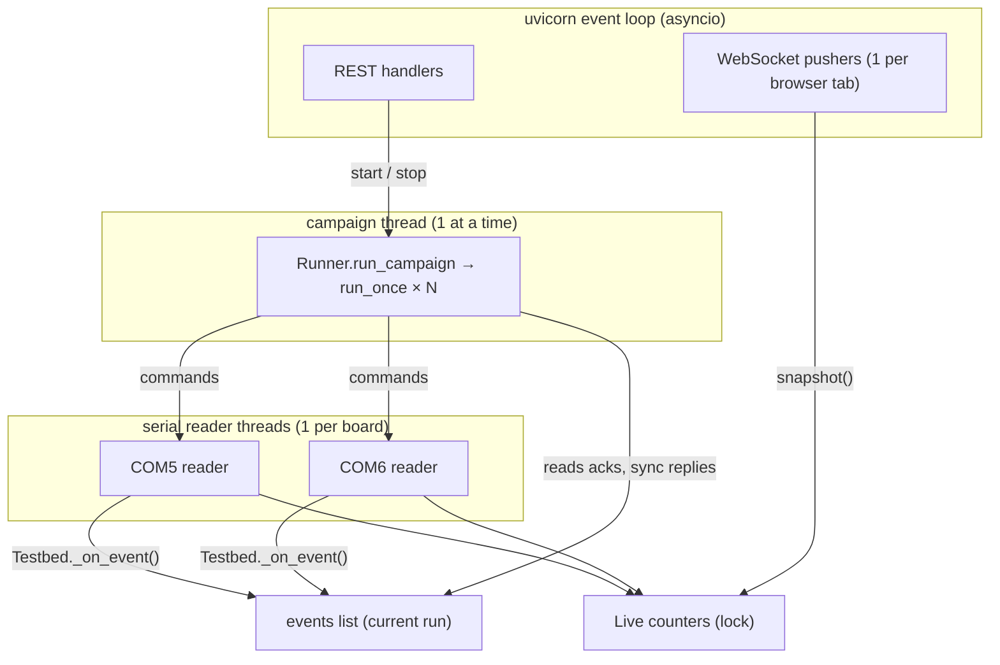
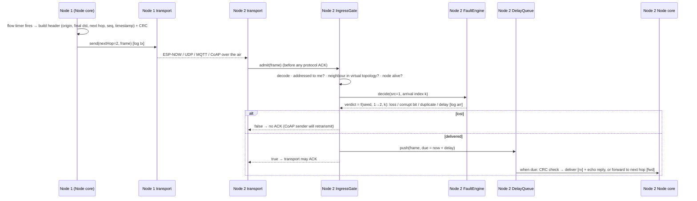
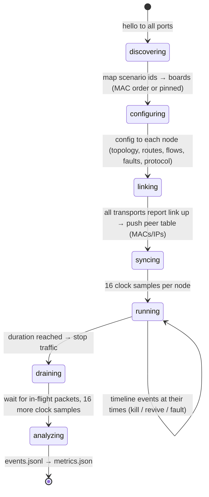

# FaultBed Software Architecture

This explains how the pieces fit together: browser, backend, boards and firmware. It also covers
how a click on **Run** becomes packets on the radio and numbers on a chart. Diagrams are
Mermaid, so they render on GitHub and in VS Code.

---

## 1. The big picture

FaultBed has three planes. Keeping them separate is the main design decision.

| Plane | Carries | Runs over | Why it is separate |
|---|---|---|---|
| **User plane** | what the experimenter sees and clicks | HTTP + WebSocket (browser ↔ PC) | UI can be replaced (CLI, scripts) without touching anything else |
| **Control plane** | commands to boards, event logs back | USB serial (PC ↔ each board) | never uses the radio under test, so measuring doesn't disturb what is measured |
| **Data plane** | the test traffic itself | ESP-NOW / UDP / MQTT / CoAP between boards | the only thing that goes over the air |



---

## 2. Where the code lives

```
firmware/                                   C++ (PlatformIO, Arduino framework)
  src/main.cpp            serial command loop; turns JSON commands into calls on the core
  src/config.cpp          JSON → NodeConfig / LinkRule structs
  src/transport.h/.cpp    Transport base class, plug-in registry, shared Wi-Fi helper
  src/transports/*.cpp    espnow · udp · mqtt · coap  (one file each)
  lib/fbcore/             portable core (no Arduino calls, unit-tested on the PC)
    node.*                routing, forwarding, traffic generation, echo/RTT, event log
    fault_engine.*        per-link fault rules, deterministic decisions, delay queue
    fb_hash.h             counter-based randomness (SplitMix64)
    packet.*              24-byte FaultBed header + CRC-16
    coap.*                minimal CoAP codec
    link.h                the ILink / IngressGate interfaces between core and transports
  wokwi.toml, diagram.json   run the same binary on a simulated ESP32 (see §8)

controller/faultbed/                        Python package
  cli.py                  `faultbed boards | run | analyze | serve`
  scenario.py             the experiment description (pydantic models, YAML load/save, sweeps)
  topology.py             presets, neighbour lists, shortest-path routes, layout for the UI
  ports.py                NodePort interface; SerialNodePort (USB or rfc2217:// URL); clocks
  sim.py                  simulated boards that speak the same protocol (development, CI)
  runner.py               Testbed (boards + event plumbing) and Runner (experiment lifecycle)
  metrics.py              analysis: PDR, latency, recovery, loss attribution, fault audit
  faults.py, hashing.py, packet.py   bit-exact Python copies of the firmware core
  web/server.py           REST + WebSocket backend
  web/static/             index.html, style.css, app.js   (the frontend; no build step)
```

---

## 3. Frontend ↔ backend

### How they are connected

There's one process. `faultbed serve` starts **uvicorn**, which runs the FastAPI app in
`web/server.py`. That app does three jobs on one port (default 8000):

1. **Serves the frontend files.** `GET /` returns `static/index.html`, which loads `style.css`,
   `app.js` and Chart.js (from a CDN). No bundler, no Node.js.
2. **REST API** under `/api/...`. The browser calls it with `fetch()` and JSON bodies for anything
   it *asks* or *changes*: load a scenario, validate it, start a run, read results.
3. **WebSocket** at `/ws`. The backend *pushes* live state to the browser every 0.5 s while the
   page is open: run progress, board status, per-flow counters, new log lines. The browser never
   polls during a run.



### REST endpoints

| Method & path | Used by | Does |
|---|---|---|
| `GET /api/state` | page load | mode (hardware/simulation), boards, protocols the firmware advertises, parameter schemas, presets, progress |
| `POST /api/boards/scan` | Testbed → Rescan | sends `hello` to every port, returns who answered |
| `POST /api/boards/identify` `{port}` | blink LED | turns the board's LED on for 3 s |
| `GET /api/scenarios` | file dropdown | lists `scenarios/*.yaml` |
| `GET / PUT /api/scenarios/{file}` | Load / Save | read or write a scenario (validated on save) |
| `POST /api/validate` | every edit | full validation + derived data: edges, routes per flow, layout, run count, time estimate, exact JSON each node will get, warnings |
| `POST /api/run` | Run | starts the campaign in a background thread (409 if one is running) |
| `POST /api/stop` | Stop | asks the runner to finish the current run early |
| `GET /api/results` | Results list | campaigns with their aggregate table |
| `GET /api/results/{campaign}/{variant}/{rep}` | Run detail | one run's `metrics.json` + scenario |
| `GET /api/download/{campaign}/{file}` | CSV / Scenario buttons | `campaign.csv`, `.json` or `.yaml` |

Validation errors come back as HTTP 422 with `[{loc, msg}]`, and the UI shows them above the form.

### WebSocket message (`/ws`, server → browser, every 0.5 s)

```json
{
  "progress": {"phase": "running", "variant": "…", "rep": 1, "reps": 3, "run_index": 2, "run_total": 12,
               "elapsed_s": 14.2, "duration_s": 30, "run_dir": "…", "error": ""},
  "busy": true,
  "boards": [{"port": "COM5", "mac": "…", "node_id": 1, "link_up": true, "ip": "…", "online": true}],
  "flows":  [{"id": 1, "src": 1, "dst": 4, "sent": 140, "delivered": 131, "pdr": 0.936,
              "last_rtt": 9.1, "rtt": [[t, ms], …]}],
  "nodes":  [{"id": 2, "down": false, "link": true, "arr": 512, "inj": 48}],
  "log":    [{"k": 87, "node": 3, "e": "down", …}]
}
```

`log` holds only lines the browser hasn't seen yet. The server tracks the last sequence number
`k` per connection. Raw per-packet events (`tx`, `arr`, `rx`…) are summed into the counters
instead of being forwarded, so the browser stays light even at hundreds of packets per second.

### Inside the frontend (`app.js`)

- One state object `S`. `S.sc` is the scenario being edited, with the same shape as the YAML file.
- Every form input has `data-bind="dotted.path"`. One `change` listener writes the value into
  `S.sc`, re-renders the builder, and calls `/api/validate`. The backend is the single source of
  truth for validation and routing, so the UI never duplicates that logic.
- The topology editor is an SVG. Nodes are draggable. Clicking a link opens two rule editors, one
  per direction (`faults.links["a->b"]`). "Click two nodes" switches the preset to `custom`.
- The Live and Results views draw with Chart.js. Charts are destroyed and recreated per view.

---

## 4. Backend internals

### Threads and who owns what



- **Serial reader threads** read bytes, split lines, parse JSON, and timestamp each line with the
  host clock (`perf_counter_ns`). They then call `Testbed._on_event`, which (a) updates board
  state (`hello`, `link`), (b) records ACKs and sync replies for the runner, (c) appends the event
  to the current run's log, and (d) feeds listeners such as the live counters.
- **The campaign thread** runs the experiment. Only one can run at a time (`App.busy` lock). The
  same lock stops a board rescan in the middle of a run.
- **WebSocket handlers** only read a snapshot under a lock. They never block the runner.

### NodePort: why hardware, simulator and Wokwi are interchangeable

The runner talks only to `NodePort` objects. Each has `open(callback)`, `send(dict)` and `close()`.

| Implementation | Connects to | Selected by |
|---|---|---|
| `SerialNodePort("COM5")` | a real ESP32 over USB | default; auto-detects USB-serial chips |
| `SerialNodePort("rfc2217://localhost:4000")` | the same firmware running in Wokwi | `--port rfc2217://…` |
| `SimNodePort` | a Python model of a board | `--sim N` |

All three speak the identical JSON protocol (§5). So the runner, metrics and UI have **no
hardware-specific code**, and you can mix kinds: `--port COM5 --port COM6 --port rfc2217://localhost:4000`.

### Clock

The runner never calls `time.sleep` directly. It uses a `Clock` (`RealClock` for hardware). The
simulator *is* a clock: its `sleep()` advances virtual time and delivers simulated events. So a
30-second simulated experiment finishes in under a second in tests, or runs at wall-clock pace in
the UI (`--sim-speed 1`).

---

## 5. Backend ↔ boards: the serial protocol

Newline-delimited JSON at 921600 baud. Commands have `"c"`; events from the board have `"e"`.
Lines that aren't JSON (ESP32 boot messages, crash dumps) are kept in `raw_tail` for debugging
and otherwise ignored.

**Commands (PC → board)**

| `c` | Payload | Effect | Reply |
|---|---|---|---|
| `hello` | – | identify | `hello` {mac, chip, fw, transports[]} |
| `config` | id, seed, ttl, neighbors, routes, flows, faults, transport{name, params} | (re)configure node, start transport | `ack` |
| `peers` | {id: {mac, ip}} | address book for unicast | `ack` |
| `sync` | h | clock sample | `sync` {h, t} |
| `start` / `stop` | – | start / stop traffic generation (stop also logs counters) | `start`/`stop` + `stats`, `tstats` |
| `kill` | hard | node failure; hard = radio stack off too | `down` |
| `revive` | – | undo kill (re-joins network if hard) | `up` |
| `fault` | src (-1 = default), rule or null | change a link rule live | `rule` |
| `stats`, `led`, `reboot` | – | counters, identify LED, restart | |

**Events (board → PC)**, each with `t` = board microseconds

| `e` | Meaning |
|---|---|
| `tx` | flow packet generated (seq, dst, next hop, ok) |
| `arr` | a frame reached the fault gate: link src, **arrival index i**, rule version, verdict (`ok`/`loss`/`cor`/`dup`), injected delay |
| `fwd` / `etx` | frame relayed / echo reply sent |
| `rx` | packet delivered to its final destination |
| `rtt` | echo reply came back to the origin (round-trip µs) |
| `drop` | dropped for a non-injected reason (crc, ttl, noroute, queue) |
| `link` | transport up/down (+ IP, channel, RSSI) |
| `down` / `up` | node killed / revived |
| `rule` | a fault rule was applied (exact values, version number) |
| `txerr`, `stats`, `tstats` | transport errors, counters |

---

## 6. Inside a node: the life of one packet



Key points:
- The **header is protocol-independent**, so routing, faults and measurements are identical for
  all four protocols. A transport only moves bytes to a node id.
- Faults apply on the **receiving side of each directed link**, so 1→2 and 2→1 are configured
  independently.
- The decision uses the **arrival index on that link**, not a shared random stream. That's why it
  is reproducible and can be audited later.
- Nothing blocks. Delays are a timed queue, and the main loop only polls serial, the transport and
  the queue.

---

## 7. One experiment from start to finish



A **campaign** is `expand(sweep) × repeats` of the above. Then `campaign.json` / `.csv` summarise
mean, sd, CV and 95% CI per variant and flow.

Analysis (`metrics.py`) reads only the files in the run folder, so any old run can be re-analysed
offline (`faultbed analyze <dir>`):
1. Fit each board's clock to the host clock (min-RTT samples, offset + drift).
2. Per flow: PDR in the window, RTT stats, one-way latency, goodput, duplicates.
3. Per lost packet: walk its route through the logged events and assign a cause.
4. Per node: replay every `arr` through the Python fault engine → conformance %; per link:
   configured vs measured loss, CI, p-value.
5. Per disruption: recovery time, outage, re-link time.

---

## 8. Virtual circuits: Tinkercad, Wokwi, or our simulator?

**Tinkercad Circuits can't do this.** It simulates Arduino-class boards and has no ESP32 and no
Wi-Fi. Third-party sources consistently report this ([example](https://macmyths.com/how-to-add-esp32-in-tinkercad/));
there's no official Autodesk statement, so check if you need to cite it. It also has no way to
expose a simulated serial port to a program on your PC, which our controller needs.

**Wokwi can, partly.** We've wired it in. Wokwi simulates an ESP32 running *your actual firmware
binary*. The VS Code extension can expose the simulated serial port as an RFC2217 TCP server
(`rfc2217ServerPort` in `wokwi.toml`, [Wokwi docs](https://docs.wokwi.com/vscode/project-config)).
pyserial connects to that URL, and so does FaultBed now:

```bash
cd firmware && pio run -e esp32dev          # same image as for real boards
# VS Code: F1 → "Wokwi: Start Simulator"     (wokwi.toml + diagram.json are in firmware/)
python -m faultbed --port rfc2217://localhost:4000 boards
```

What Wokwi is good for, and its limits:
- ✅ Run and debug the **real firmware** without a board: boot, serial protocol, config parsing,
  traffic generator, fault engine, LED. This is the best use: catch firmware bugs before flashing.
- ✅ Wi-Fi works through Wokwi's gateway. The private gateway (paid plan) lets the simulated
  ESP32 reach your PC as `host.wokwi.internal`, e.g. the Mosquitto broker for MQTT runs
  ([Wokwi Wi-Fi guide](https://docs.wokwi.com/guides/esp32-wifi)).
- ⚠️ One simulated ESP32 per simulator instance; more boards mean more VS Code windows with
  different ports. The simulator tab must stay visible or the simulation pauses.
- ❌ ESP-NOW between simulated boards, and direct UDP/CoAP between separate instances, are not
  documented as supported. Assume multi-node radio experiments in Wokwi won't work.
- ❌ Its radio and timing are idealised, so its numbers are not results.

**Our own simulator (`--sim N`)** is the multi-node virtual testbed. It models 4–5+ boards, all
protocols, failures and topologies, deterministically, in CI. It runs a Python copy of the
firmware core, not the binary.

| Need | Use |
|---|---|
| Develop the controller, UI, analysis; CI | `--sim N` |
| Test the real firmware binary without a board | Wokwi + `rfc2217://` |
| Mix one virtual board into a real setup | `--port COM5 --port COM6 --port rfc2217://localhost:4000` |
| **Results for the report** | **real ESP32 boards** (the goal) |

---

## 9. Extending

| To add | Touch |
|---|---|
| A protocol | one file in `firmware/src/transports/` + `FB_REGISTER_TRANSPORT`; optionally a form schema in `TRANSPORT_PARAMS` (server.py) and a channel profile in `sim.py` |
| A fault type | `LinkRule` + `FaultEngine::decide` (C++) **and** `faults.py` (Python) with a new stream id; add a cross-language test vector |
| A metric | `metrics.analyze()` → add a field; show it in `renderRun()` (app.js) |
| A topology preset | `topology.build_edges()` (+ `layout()`) |
| A timeline action | `TimelineEvent`, `Runner._apply_timeline`, firmware command, `metrics._recovery` if it is a disruption |
